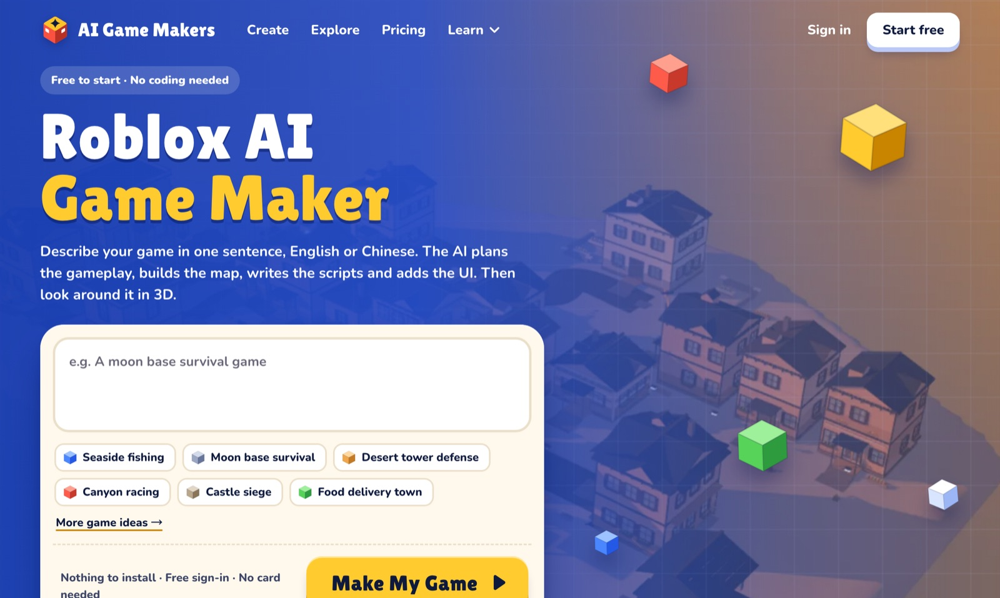
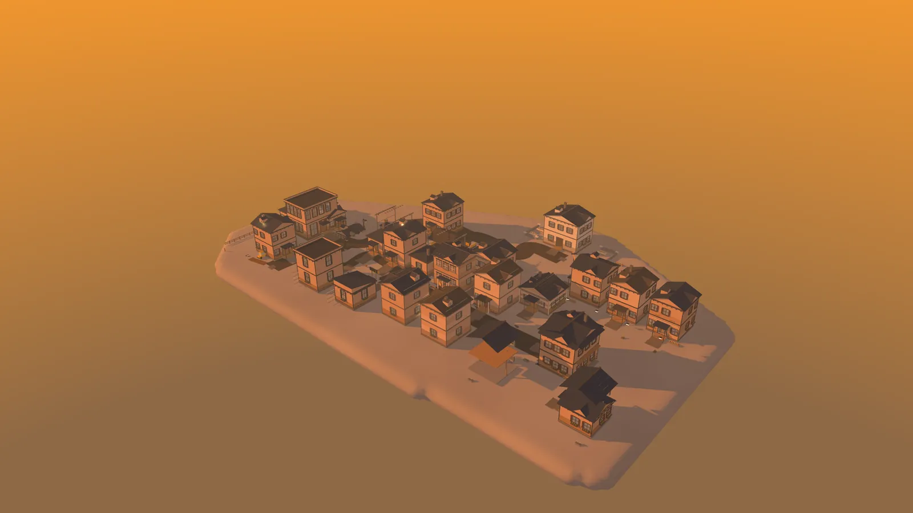
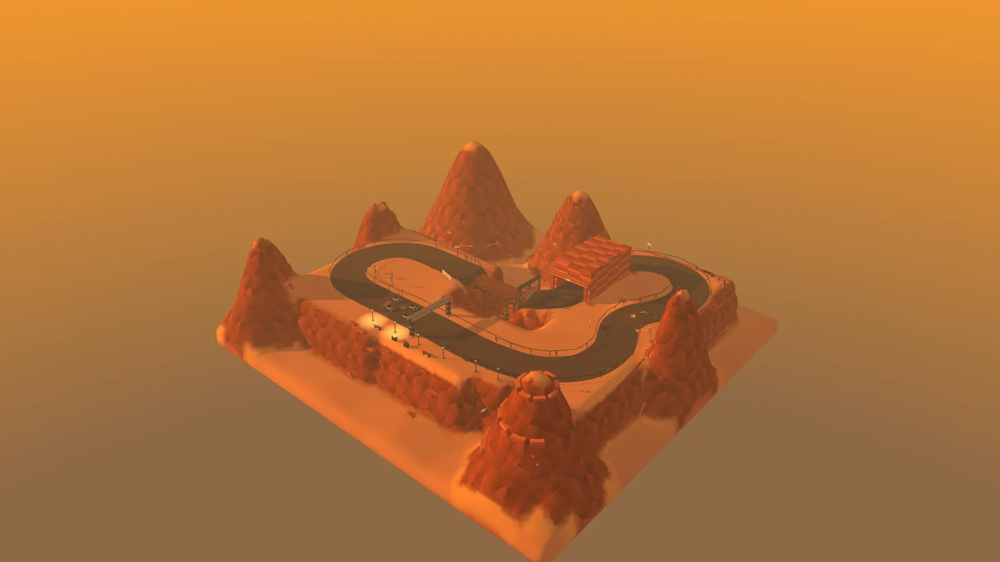
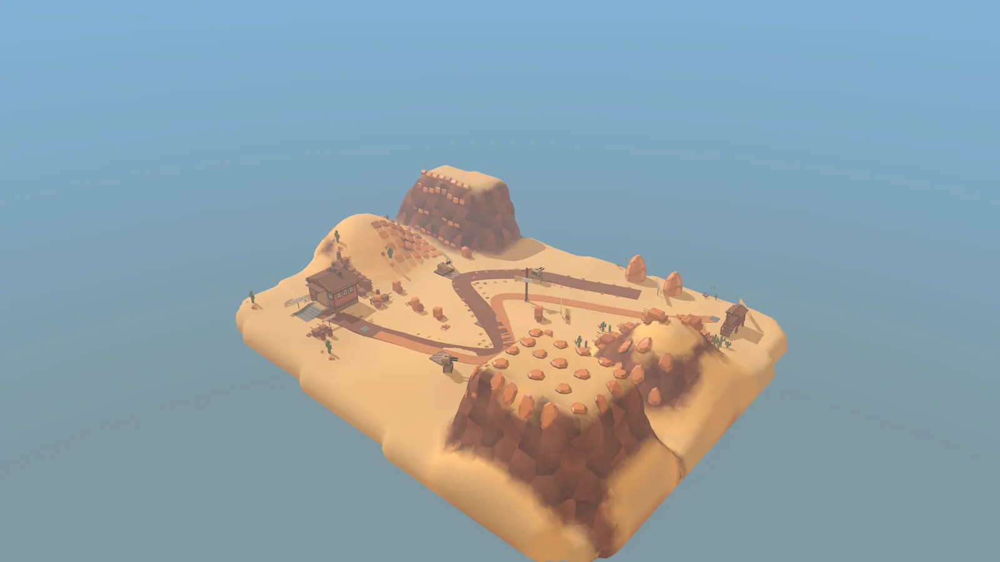
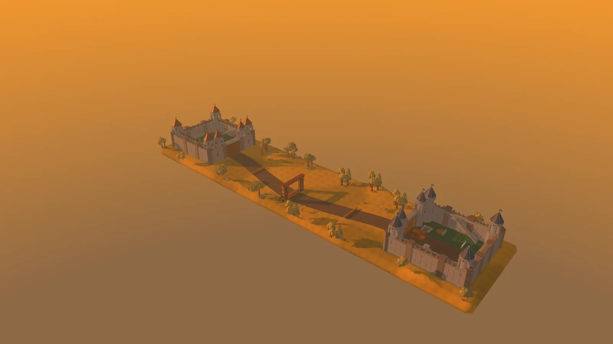

  

<h1 align="center">Roblox AI Game Maker</h1>

  <b>Turn one sentence into a full Roblox game. No coding.</b> 
  <a href="https://aigamemakers.com/?utm_source=github">Website</a> ·
  <a href="https://aigamemakers.com/create/new?utm_source=github">Make a game free</a> ·
  <a href="https://aigamemakers.com/roblox-game-ideas?utm_source=github">Game ideas</a> ·
  <a href="https://aigamemakers.com/open-rbxl-file?utm_source=github">Roblox Studio guide</a>

[AI Game Makers](https://aigamemakers.com/?utm_source=github) is a free-to-start **Roblox AI game maker**. Describe your game in one sentence, in English or Chinese. The AI plans the gameplay, builds the 3D map, writes the Luau scripts and adds the UI. You get one `.rbxlx` file that opens in free Roblox Studio.

> **About this repository:** this is the project's home on GitHub, with docs, example maps and a place for feedback. The generator itself runs as a web app at [aigamemakers.com](https://aigamemakers.com/?utm_source=github), so there is nothing to install or build here.

## What It Builds

- **A whole 3D map:** terrain, buildings and paths. The example maps below have 6,097 to 16,613 parts each.
- **Game rules in Luau:** the rules and scoring, written as real Roblox scripts.
- **On-screen UI:** the buttons and counters players see.
- **Sky and lighting:** atmosphere, sun rays and bloom.

Everything stays editable in Roblox Studio. Open a script, change a number, press Play and see what happens.

## Example Maps

Each map came from one prompt. Prompts are shortened.

| | |
| --- | --- |
|  |  |
| **Food Delivery Town**: "Deliver meals around a busy town on an e-scooter." 16,613 parts | **Canyon Racing**: "Race a red canyon track with jumps, tunnels and narrow bridges." 14,555 parts |
|  |  |
| **Desert Tower Defense**: "Five waves, three tower types, coins to upgrade towers." 12,854 parts | **Castle Siege**: "Defend your castle, ram the enemy gate, break in first." 7,188 parts |

You can spin and zoom all 10 example maps in 3D on the [homepage](https://aigamemakers.com/?utm_source=github).

## How It Works

1. **Describe your game.** Type one sentence, like *"Make me a Roblox game where players catch fish, sell them and buy better rods."*
2. **Watch it build in 3D.** The AI plans the game, then builds it zone by zone in your browser. A first version takes about 35 minutes on average (24 to 50 minutes in our tests). You can close the page and come back later.
3. **Open it in Roblox Studio.** Download the `.rbxlx` file, open it in free Roblox Studio, press Play to test, then publish. Want changes? Tell the AI on your game's page. Every version is saved, so you can go back.

New to Studio? Read [how to open an .rbxlx file in Roblox Studio](https://aigamemakers.com/open-rbxl-file?utm_source=github).

## What's in the .rbxlx File

| Where | What |
| --- | --- |
| `Workspace` | the map, terrain and spawn point |
| `ServerScriptService` | game rules and scoring |
| `StarterPlayer`, `ReplicatedStorage` | player scripts and UI |
| `Lighting` | sky and light effects |

`.rbxlx` is the text version of a Roblox place file (`.rbxl`). Studio opens both.

## How It Compares

| | AI Game Makers | A chat AI like ChatGPT | Building it yourself |
| --- | --- | --- | --- |
| Coding | None | You paste and fix it | You write Luau |
| Map | The AI builds it | You build it | By hand |
| You get | One `.rbxlx` file | Code snippets | What you build |
| First version | About 35 minutes | Depends on your fixes | Days to weeks |

## Prompt Ideas to Try

- "Catch different fish, sell them and upgrade your rod."
- "Collect oxygen and parts, fix the radio tower, call a rescue ship."
- "Mine, plant trees and build houses on a tiny planet."
- "Lead a squad, capture points, build troops, destroy the red base."
- "Solve traps, cross rope bridges, find the temple treasure."

More in [Roblox game ideas](https://aigamemakers.com/roblox-game-ideas?utm_source=github).

## FAQ

**Is it free?**
Your first full game is free. Sign in, no card needed. See [pricing](https://aigamemakers.com/pricing?utm_source=github) for more games.

**Do I need to install anything?**
No plugin, no API key and no Studio connection while it builds. You only need free Roblox Studio at the end.

**Does the AI test the game?**
A program checks the parts, scripts and spawn point. It doesn't play the game for you, so press Play in Studio and try it.

**Is the generator open source?**
No. This repository holds docs and examples. The generator runs on [aigamemakers.com](https://aigamemakers.com/?utm_source=github).

**Is this an official Roblox tool?**
No. AI Game Makers is an independent tool, not affiliated with Roblox Corporation.

## Feedback

Found a bug or have an idea? [Open an issue](../../issues) in this repository.

---

Roblox and Roblox Studio are trademarks of Roblox Corporation. AI Game Makers is not affiliated with or endorsed by Roblox Corporation.
